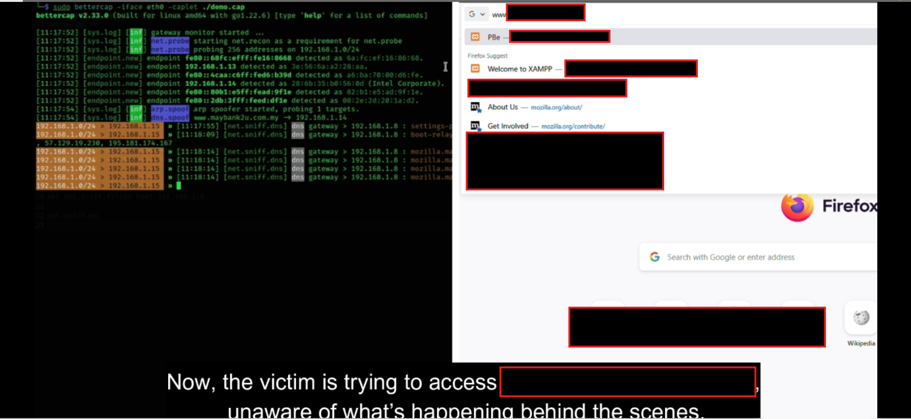
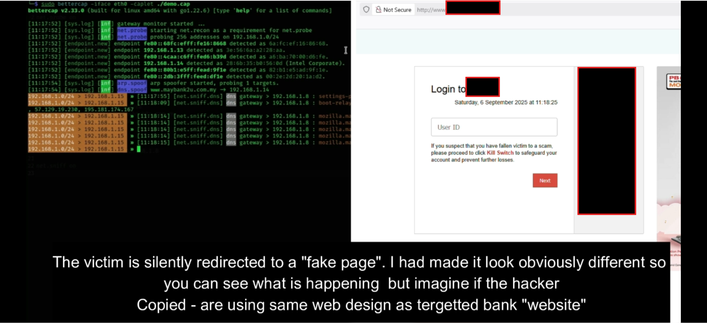

# Controlled Awareness Demonstration

The project includes a controlled cybersecurity awareness scenario designed to help users visualize why an untrusted network should not automatically be considered safe.

The demonstration is presented for **defensive security education and user awareness**.

 

## 01 · Untrusted Network Awareness Scenario

The first scenario presents the network activity and user browsing experience side-by-side.

### Awareness Concepts Demonstrated

`UNTRUSTED NETWORK`
&nbsp;
`NETWORK RISK`
&nbsp;
`USER AWARENESS`

  

`SUSPICIOUS BROWSING`
&nbsp;
`DECEPTIVE EXPERIENCE`
&nbsp;
`RISK RECOGNITION`

 

The purpose of this visual is to demonstrate that activity occurring within an untrusted network may not always be obvious to the user.

The public portfolio version intentionally removes or obscures target-specific identifiers and sensitive network information.

 

---

## 02 · Browser Security Warning

One of the most important lessons demonstrated in the awareness scenario is the importance of paying attention to browser security indicators.

### Key Warning Sign

## ⚠ NOT SECURE

A browser displaying **Not Secure** should immediately increase user caution, particularly before entering usernames, passwords, financial information, or other sensitive data.

### Users Should Stop and Check

✓ Is the website address correct?  
✓ Is the connection protected by HTTPS?  
✓ Was there an unexpected redirect?  
✓ Does the login page look different than expected?  
✓ Is the current network trustworthy?  
✓ Is sensitive activity necessary on this network?

 

> **Security Awareness Principle**  
> A familiar-looking page should never be the only reason a user trusts a website. The domain, secure connection, browser warnings, and context should also be verified.

 

---

## Why the Demonstration Is Sanitized

This public portfolio intentionally does not reproduce all details from the original controlled training environment.

The visual material has been sanitized to avoid unnecessarily exposing:

- Target-specific identifiers
- Real service branding where inappropriate
- Network addressing details
- Reusable configuration information
- Credentials or personal information
- Operational attack instructions

The objective of this case study is to demonstrate **cybersecurity awareness, risk communication, and preventive education**.

 

---
